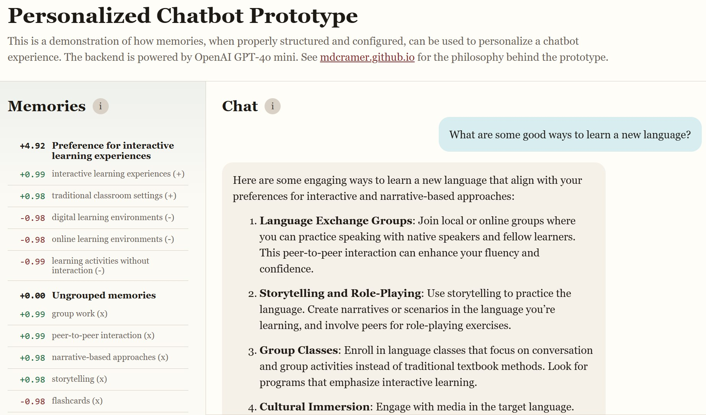
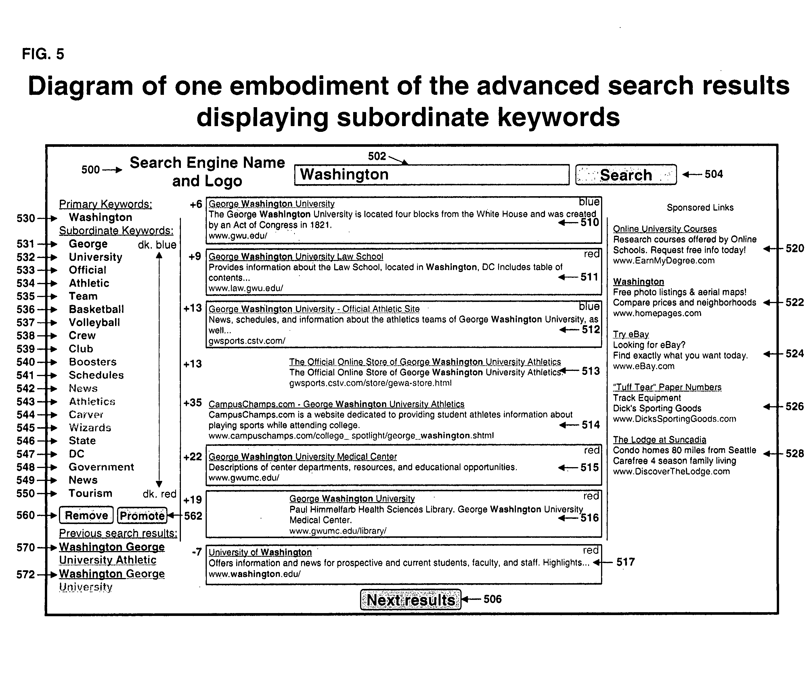

I did something with the MyMemoChat prototype that some folks might find curious. I put a memory sidebar on the left so you can see what the prototype remembers, how it groups related memories and how much weight each memory carries.

Exposing that much detail about a personalization engine can be handy when you're building one. If a preference ends up in an unexpected cluster or a memory carries more weight than expected, the sidebar gives you a place to look. I'd keep this level of detail in the prototype, where it helps explain and debug the system.

## Patent: Adaptive user interface for real-time search relevance feedback

I built something similar in the early days of [Rank Dynamics](/rank-dynamics/). I wish I had saved a screenshot, but Figure 5 in the issued patent [Adaptive user interface for real-time search relevance feedback](https://patents.google.com/patent/US8117197B1/en){:target="_blank"} shows what we built.

The primary keywords came from the user's query. The subordinate keywords came from the user's behavior. When a user clicked a result, we extracted terms from its title and snippet and weighted them using [TF-IDF](https://en.wikipedia.org/wiki/Tf%E2%80%93idf){:target="_blank"}, dwell time and other factors. Terms from skipped results also got negative weights. We used [stemming](https://en.wikipedia.org/wiki/Stemming){:target="_blank"}, [WordNet](https://en.wikipedia.org/wiki/WordNet){:target="_blank"}, [n-grams](https://en.wikipedia.org/wiki/N-gram){:target="_blank"} and [clustering](https://en.wikipedia.org/wiki/Cluster_analysis){:target="_blank"} to relate those inferred interests to other results. The system used the weighted terms to reorder results in real time, and the sidebar even let users adjust the weights themselves.

On the way to reaching 5 million daily active users, we tested dynamic ranking on Google and eBay search results. In the [Google study](/rank-dynamics/evaluating-surf-canyons-technology-part-2/), users were 25–40+% more likely to click dynamically ranked links. Our [first eBay experiment](/rank-dynamics/the-proof-is-in-the-pudding/) showed a 32% increase in sales and a [follow-up experiment](/rank-dynamics/more-pudding/) found that dynamically ranked results drew more clicks beyond the first ten.

## Bye-bye guts

I've always been skeptical of asking people to tune their own search results. A potential angel investor once showed me [Yahoo! Mindset](https://www.seroundtable.com/archives/002003.html){:target="_blank"}, an experimental search interface with a slider that shifted results between shopping and research. After working on Rank Dynamics, I had a hard time imagining people ever reaching for a slider to try to indicate their current intent. (He did not invest.)

That experience and others shaped my [philosophy](/rank-dynamics/the-four-quadrants-of-personalization/) around personalization. People often have trouble articulating what they want, and refining a set of controls takes effort. Their actions can give you a better signal and, when it comes to search, users only want to do two things: enter keywords and click results. Long-term preferences are useful, but the real power comes from real-time personalization, especially when signals about what a user wants right now have a half-life measured in minutes.

We dropped the Rank Dynamics sidebar early. I liked seeing what was happening under the hood but the detail overwhelmed and confused users. I expect the MyMemoChat memory sidebar to meet the same fate. For now, everyone will still get to peek at the guts.