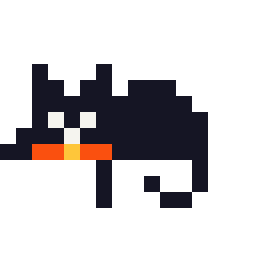

Anyone who knows me mildly well is aware that I'm a Francophile. I lived in France for almost four years, learned to speak the language fluently, read the unabridged version of _Les Miserables_ in _version originale_, still have many friends there and try to visit as often as I can. Since living in Paris in the '90s, I've dreamed of one day living there again. That's still a plan.

## Mistral _rentre dans la maison_

That being said, I added Mistral to the backend of [MyMemoChat](http://mymemochat.com/){:target="_blank"}, to power the chat (`mistral-small-latest`) as well as the embeddings (1024-dimensional `mistral-embed`), not because it's a frontier lab based out of Paris, but... really it's mostly because of that.

Actually, I also want to try it out. I could simply use [Le Chat](https://chat.mistral.ai/){:target="_blank"} but plugging Mistral into the backend of MyMemoChat will enable me to see how a personalization layer will behave on top of the European model.

## Implementation was _fastoche_

I previously used Codex through the command line but for this assignment I used Codex in the desktop app. Having forgotten my workflow from a few months ago, ChatGPT quickly helped me to remember the build and deploy process. After creating a Mistral API key and entering a few prompts, I had it working locally. As soon as the pull request is approved by my collaborator, it'll be live. The whole thing took me about an hour, although I spent a decent amount of time just poking around the docs.

## Compare and contrast

OpenAI's `gpt-4o-mini` is still on the backend. I'll eventually find a way to switch models live, but for now I can change to it by updating the config file or through a variable on [Railway](https://railway.com/){:target="_blank"}. So once the evals are fully up and running it'll be interesting to see how the models compare. While there are countless models to choose from, I'll start with these two.

### Chat models

Specifications and standard API prices checked on November 9, 2026. Prices exclude caching, batch discounts and taxes. The Mistral column describes Small 4. `mistral-small-latest` is a moving alias, so reproducible evaluations should record the dated model version.

I was surprised to find that the two chat models have identical standard API prices. That's a coincidence but makes the comparison especially interesting. At the same price per token, which model makes better use of the personalization layer? (Actual costs may still differ, however, because the models can tokenize text differently and produce different-length replies.)

| Detail | Mistral Small 4 | OpenAI GPT-4o mini |
| --- | --- | --- |
| Model ID | `mistral-small-latest` | `gpt-4o-mini` |
| Dated model ID | `mistral-small-2603` | `gpt-4o-mini-2024-07-18` |
| Released | March 16, 2026 | July 18, 2024 |
| Parameters | 119 billion total (mixture of experts) | Not publicly disclosed |
| Context window | 256,000 tokens | 128,000 tokens |
| Input / output | Text and images / text | Text and images / text |
| Input price per million tokens | $0.15 | $0.15 |
| Output price per million tokens | $0.60 | $0.60 |
| Model weights | Available under Apache 2.0 | Not publicly released |

Sources: [Mistral Small 4 model card](https://docs.mistral.ai/models/mistral-small-4-0-26-03){:target="_blank"}, [Mistral release announcement](https://mistral.ai/news/mistral-small-4/){:target="_blank"}, and [OpenAI GPT-4o mini model documentation](https://developers.openai.com/api/docs/models/gpt-4o-mini){:target="_blank"}. The OpenAI documentation currently labels GPT-4o mini deprecated; availability should be checked before future evaluations. Parameter counts alone do not establish which model will work better for personalization.

### Embedding models

These models turn memory text into numerical vectors for similarity calculations and clustering. They do not generate chat replies. MyMemoChat selects the embedding model automatically from the chat model's provider.

| Detail | Mistral | OpenAI |
| --- | --- | --- |
| Model ID | `mistral-embed` | `text-embedding-3-small` |
| Released | December 11, 2023 | January 25, 2024 |
| Default vector dimensions | 1,024 | 1,536 |
| Dimensions used in MyMemoChat | 1,024 | 256 |
| Input price per million tokens | $0.10 | $0.02 |
| Parameters | Not publicly disclosed in the cited documentation | Not publicly disclosed in the cited documentation |

Sources: [Mistral Embed model card](https://docs.mistral.ai/models/mistral-embed-23-12){:target="_blank"}, [Mistral text embeddings guide](https://docs.mistral.ai/inference/embeddings/text_embeddings){:target="_blank"}, [OpenAI embedding model documentation](https://developers.openai.com/api/docs/models/text-embedding-3-small){:target="_blank"}, [OpenAI embeddings guide](https://developers.openai.com/api/docs/guides/embeddings){:target="_blank"}, and [OpenAI release announcement](https://openai.com/index/new-embedding-models-and-api-updates/){:target="_blank"}.

Mistral embeddings currently cost five times as much per input token. MyMemoChat stores four times as many vector components with Mistral as with its reduced OpenAI setting, although that does not translate directly into four times the SQLite storage. More dimensions do not automatically mean better personalization. The vectors come from different embedding spaces and cannot be compared directly; MyMemoChat excludes incompatible vectors from clustering when switching providers. Existing memory text remains until cleared or expired.
